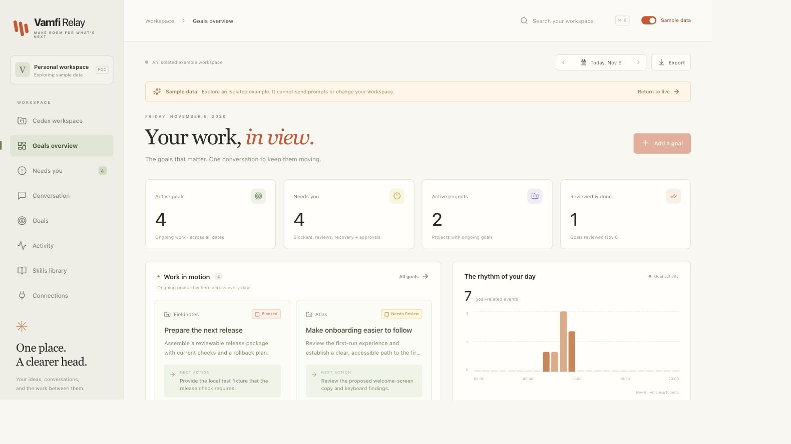

# Vamfi Relay

**One conversation. Every project in view.**

Working across Codex chats makes it easy to lose the thread: which project was this for, what finished, and what needs attention? Vamfi Relay is an open-source local dashboard that brings those chats into a project view and gives new work one master conversation.

Connect the Codex installation on your machine. Relay discovers stored chats, groups them by their recorded project directory, and lets you inspect history before continuing in Relay. Meaningful goals appear on the dashboard; casual questions stay in chat. Project agents work in separate sessions and report progress and evidence back to the same conversation.

**Prototype scope:** Codex is the only implemented provider. Relay observes live execution that it owns; existing desktop chats are historical context with **unknown external live status**. It does not take over a desktop chat or monitor every Codex process on your computer.

## Run locally



*The sample goal dashboard. The Codex workspace view separately discovers your real local chats.*

Use Node.js **22.13 or newer** and npm. Live work requires your own authenticated Codex installation; complete sign-in privately in Codex. macOS is the initial real-provider qualification platform. Linux and Windows are not yet qualified for the full workflow.

```sh
git clone https://github.com/VAMFI/vamfi-relay.git
cd vamfi-relay
npm ci
npm run build
npm run relay -- start --open
```

The last command starts a background service and asks your browser to open **http://127.0.0.1:4318**. If a browser cannot be opened, the command prints the URL. It does not install a login service. Use `npm run relay -- status` and `npm run relay -- stop` to manage it. `npm start` runs in the foreground.

On macOS, Relay prefers an executable CLI bundled with `/Applications/ChatGPT.app`, then `/Applications/Codex.app`, then `codex` on `PATH`. Set `RELAY_CODEX_BIN` to choose an executable explicitly. Protocol compatibility depends on the installed CLI; see [verification](docs/VERIFICATION.md#cli-compatibility).

This is a GitHub source distribution. There is no published npm installer; `private: true` prevents accidentally publishing the application package.

## Your first session

1. **Open your Codex workspace.** Relay discovers stored chat metadata through the installed Codex app-server and groups it by recorded working directory, using Codex project names when available. Discovery does not start tasks or grant project write access. If discovery is unavailable, inspect Connections and refresh after resolving the provider issue.
2. **Find the project.** Browse its chats and load the history you need. The local generated memory summary, when available, is supplementary context; it may be incomplete or stale.
3. **Continue in Relay.** Review the bounded context handoff, add your next request, and acknowledge that an external agent may still be working. Relay carries that context and its recorded project directory into the master conversation. Project execution uses separately registered Relay sessions. The original Codex chat remains untouched. Sending the reviewed context to Codex for a response uses your model service and account limits.
4. **Give substantial work a goal.** Register the intended directory, specify an objective and next action, and choose its permissions. New registrations default to read-only. Ordinary conversation does not automatically become work in motion.
5. **Review and run.** Queue one action or draft a plan of 1–8 ordered steps. Review the exact steps, choose automatic continuation or a pause after each, and approve the plan. The master can draft a plan but cannot approve it for you.
6. **Review outcomes.** Work in motion shows ongoing goals across projects and dates. Needs you collects blockers, recovery holds, and review requests. Inspect the changes and evidence before adding a completion note and marking a goal done.

Selecting another project preserves the master conversation. Each project has a persistent execution session and one active run at a time. Other accepted work waits in a durable queue. Background capacity is configurable from 1–3, shared by project runs and read-only specialists. Queued and held runs do not consume running capacity; the queue accepts at most 50 unfinished project runs.

A successful provider turn is an execution record, not proof that its goal is complete. A plan advances only after both a successful turn and a `ready` agent-reported checkpoint. Missing or blocked checkpoints stop advancement. Final acceptance remains a separate user action.

## Discovery, memory, and privacy

Relay uses supported app-server methods to list chats and read history on demand. Project grouping follows chat metadata, not a claim that every chat has been semantically classified. Missing directories, limited catalog coverage, unavailable history, and unsupported protocol methods must remain visible. Relay does not open or merge Codex's internal databases.

Browsing the catalog alone sends no model prompt. During a conversation, the master can search relevant chat metadata or retrieve selected history and memory through a bounded read-only tool. It does not automatically load all history into every request.

The memory view reads the known local generated summary when present. It does not recursively scan your home directory, copy authentication files, rewrite generated memory, or establish that an old summary is currently true. Imported history and memory are untrusted context, never permission to run commands.

Relay's UI, catalog, and application records stay on your machine. Model requests use Codex and its configured remote service. Relay has no community publishing or cloud sync. Review exports, screenshots, logs, and backups before sharing: they can contain private conversations, project paths, and results.

## Configuration

| Setting | Default | Override |
| --- | --- | --- |
| Application state | `~/.local/state/vamfi-relay` | `RELAY_DATA_DIR` |
| Initial master/project directory | Repository `workspace/`, resolved from the server location | `RELAY_WORKSPACE` for fresh state |
| HTTP port | `4318`, on loopback | `RELAY_PORT` (1024–65535) |
| Codex executable | macOS app bundle, then `PATH` | `RELAY_CODEX_BIN` |
| Master and specialist permissions | Read-only | No write mode |
| Registered project permissions | Read-only | Explicit workspace-write selection while idle |

Keep evaluation data outside the checkout. For example, in a shell that supports these commands:

```sh
evaluation_dir="$(mktemp -d "${TMPDIR:-/tmp}/vamfi-relay-evaluation.XXXXXX")"
mkdir "$evaluation_dir/workspace"
RELAY_DATA_DIR="$evaluation_dir/data" RELAY_WORKSPACE="$evaluation_dir/workspace" RELAY_PORT=4319 npm start
```

Choose directories intended for the work. Read-only restricts writes; it does **not** isolate filesystem reads to the selected workspace. Use a suitably isolated environment when unrelated local files must be inaccessible.

## Pause, restart, and recovery

Pausing or cancelling a goal stops further scheduling before requesting interruption of its active turn. An interruption acknowledgment alone does not establish that a turn or all its filesystem effects have ended. Inspect the final status and evidence.

After restart or disconnection, never-started queued work stays **held** and active attempts become interrupted. Connecting Codex does not replay them. Open Needs you, review the goal, and resume explicitly. Failed, interrupted, cancelled, or uncertain plan steps require a retry acknowledgment; earlier attempts remain visible. Finished steps are retained. Changed project permissions require renewed plan review.

Automatic continuation is limited to the remaining steps of the exact approved plan. There is no automatic retry or unbounded execution loop.

## Service and backups

Use the same data-directory and port overrides for every command addressing a separate instance:

```sh
npm run relay -- status
npm run relay -- stop
npm run relay -- backup /absolute/private/path/relay-backup.json
RELAY_DATA_DIR=/absolute/private/path/empty-relay-restore npm run relay -- restore /absolute/private/path/relay-backup.json
```

`start` is idempotent for the matching instance and rejects a conflicting port. `stop` verifies service identity and refuses unfinished work. `stop --stop-running` explicitly requests interruption and holds the queue. Shutdown waits for the owned provider process; if its exit cannot be confirmed, Relay retains its listener and data-directory lock. It does not kill arbitrary PIDs. Service output goes to `relay-service.log` in the private data directory.

Backups require a new file in an existing private directory and include an integrity checksum. **They are not encrypted** and can contain conversations, paths, instructions, and results. Do not commit or upload them. The checksum detects corruption, not the authenticity of an untrusted backup.

Restore accepts a supported snapshot into an **empty, offline data directory**. Start the restored service explicitly and inspect recovery holds. A Relay backup does not include project files, Codex authentication, or provider-owned chat storage.

## Optional skills

Relay accepts bounded Markdown documents. Preview their exact contents, review the warnings, and save them. Skills start disabled and need a separate enable action; select an enabled document as context for a future request.

Importing a skill does not run scripts, install packages, or change Codex's installed skills. Review is not a security certification. Native Codex plugins and installed skill instructions are not implicitly enabled by Relay.

## Upgrading existing state

Back up your local state before upgrading. The v0.2/v0.3 migrations retain existing messages, tasks, and events; old questions do not become goals. Plans, progress notes, queue state, and recovery holds are additive. Older provider sessions may need a one-time rollover when the tool contract changes. Relay keeps visible history and a bounded labeled handoff; interrupted attempts are never automatically replayed.

## Development and verification

```sh
npm run dev
npm test
npm run build
```

The development command prints the UI URL; the API defaults to port 4318. Tests use disposable state and include provider fixtures. A real provider check is separate and consumes the contributor's authorized account usage.

For a fictional browser preview without Codex, run `node scripts/preview-fixture.mjs` after building and open `http://127.0.0.1:4320`. Its chats, memory, and execution are synthetic.

To repeat the real two-project qualification, explicitly run `node scripts/verify-usecase.mjs --live`. It uses your existing Codex sign-in, creates synthetic source chats and temporary projects, and permits at most 30 provider turns. Evidence and disposable workspaces stay local for inspection; do not publish them. This optional check is separate from CI and uses your account's model usage.

**v0.4 local qualification passed.** Automated checks passed 174 tests on Node 22.23.2 and Node 24.22.1, the production build, and a dependency audit with zero reported vulnerabilities. A real Codex pilot passed ten phases across two projects and one master conversation, including reviewed handoffs, persistent goals, restart holds, and explicit retry. Desktop/mobile browser checks passed using synthetic provider events. Clean exported-tree verification, source publication, and remote CI remain pending. See [the verification log](docs/VERIFICATION.md) for evidence, source binding, and limits.

The [v0.4 contract](docs/WORK-V4-CONTRACT.md) defines acceptance. See [architecture](docs/ARCHITECTURE.md), [research](docs/RESEARCH.md), [roadmap](docs/ROADMAP.md), and [contribution guidance](CONTRIBUTING.md).

## Preparing a public source snapshot

Release preparation uses an explicit source-file allowlist. It does not copy existing Git history, personal agent configuration, internal task tracking, application data, or local verification artifacts:

```sh
node scripts/prepare-release.mjs --check
node scripts/prepare-release.mjs /absolute/new-release-directory
```

The destination must not exist and must be outside the checkout with an existing parent directory. The exporter records the copied files and SHA-256 digest in `SOURCE-MANIFEST.json`. It refuses linked files and common private path/record markers; this check does not replace a full review for sensitive content.

Run `npm ci`, `npm test`, and `npm run build` inside the exported tree. Inspect that tree, use a public Git author identity, and initialize fresh public history only after verification. Keep the original local history and personal evidence private. Publishing source and enabling GitHub private vulnerability reporting are explicit release steps; the export command performs neither.

## License and security

Vamfi Relay is licensed under [MIT](LICENSE). Dependency attribution is in [Third-party notices](THIRD_PARTY_NOTICES.md). Report vulnerabilities privately using [the security policy](SECURITY.md).

Relay is an independent Vamfi project, not an OpenAI product. Local prototype availability does not imply production suitability, support for other agents, remote access, or a hosted community service.
